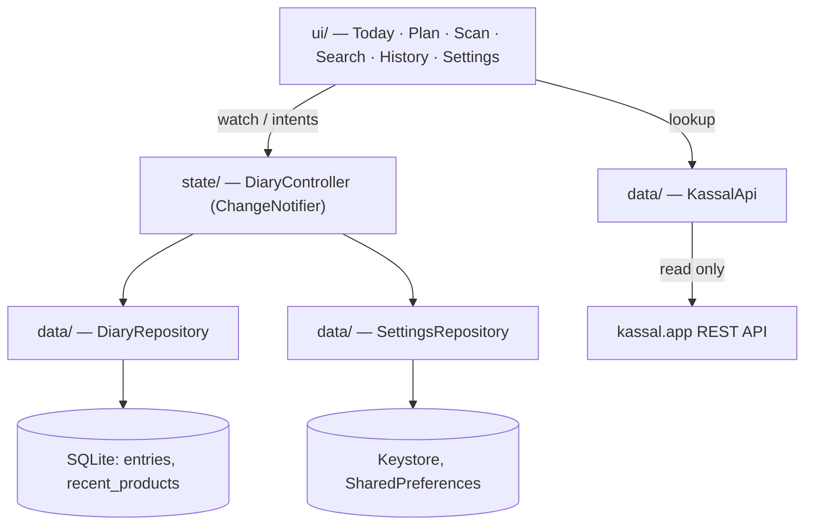

# Food Lens

**Calorie and nutrition tracking for Norwegian groceries.**

[](https://github.com/andreashenriksen/food_lens/actions/workflows/ci.yaml)
[](LICENSE)
[](https://flutter.dev)
[](#platform-support)

Product data comes from [Kassalapp](https://kassal.app), which indexes Norwegian
grocery chains, barcodes and product names from a Norwegian shop resolve
reliably.

## What it does

- **Scan a barcode** to look up a product's nutrition declaration.
- **Search by name** across Norwegian grocery products.
- **Set a daily calorie limit**, optionally with a protein/carb/fat split, and
  get a suggested limit from the Mifflin-St Jeor equation.
- **Plan the day ahead.** Planned items sit in the same list as eaten ones and
  are ticked off as you go, so you can see before you eat whether the day's
  plan fits the limit.
- **Track intake per day**, broken down by meal, with a 14-day history.

Everything you log is stored locally in SQLite. The Kassalapp API is only ever
read from.

## Setup

### 1. Get a Kassalapp API key

The app needs one to look anything up.

1. Create a free account at [kassal.app](https://kassal.app).
2. Generate an API key under your profile (`kassal.app/profil/api`).
3. Open **Innstillinger** in the app and paste the key in.

The key is stored in the platform keystore/keychain via `flutter_secure_storage`
and is only ever sent to `kassal.app`.

For development you can bake it in instead:

```bash
flutter run --dart-define=KASSAL_API_TOKEN=your_key_here
```

The free tier allows 60 requests per minute. Searches are debounced and
barcode results are cached locally to stay well inside that.

### 2. Run it

```bash
flutter pub get
flutter run
```

## Architecture



```
lib/
  main.dart                  app entry, providers, localisation
  src/
    models/                  Nutrients, Product, DiaryEntry, DailyGoal, DaySummary
    data/                    Kassalapp client, SQLite, repositories
    state/                   DiaryController — selected day, goal, entries
    ui/                      screens and widgets
```

`DiaryController` is the single owner of the viewed day, the goal and that day's
entries, which is what keeps Today and Plan in
sync when either one writes.

### Decisions worth knowing before changing the code

- **`Nutrients` is used for both per-100 reference values and absolute
  amounts.** `scale()` converts between them. Every field is nullable, because
  a null means "not declared" and must not be summed as zero.
- **Planned and eaten items share one table**, distinguished by
  `EntryStatus`. That is what lets a plan be ticked off without retyping it.
- **Diary entries store resolved nutrients**, not a product reference, so
  history stays correct if a declaration changes or a product is delisted.
- **Kassalapp's nutrition `code` vocabulary is not formally documented.**
  `Nutrients.fromKassalList` matches on aliases and falls back to the Norwegian
  display name; [`test/nutrients_test.dart`](test/nutrients_test.dart) pins the
  cases that have bitten (kJ-only energy, sodium vs. salt, unsaturated fats).
- **Platform detection deliberately uses `kIsWeb` and `defaultTargetPlatform`
  rather than `dart:io`'s `Platform`**, which compiles on web but throws the
  moment it is read — that failure kills `main()` before `runApp()` and shows
  up as a blank white page with nothing in the console.

The database backend is chosen per platform in
[`AppDatabase.initPlatform`](lib/src/data/database.dart): the native plugin on
mobile, `sqflite_common_ffi` on desktop, and `sqflite_common_ffi_web` on web.
The web build needs `web/sqlite3.wasm` and `web/sqflite_sw.js`, which are
committed; regenerate them with:

```bash
dart run sqflite_common_ffi_web:setup
```

## Platform support

| Target | Status |
|---|---|
| Android / iOS | **Primary target.** Everything works, including scanning. |
| Web (Edge/Chrome) | Works. Scanning uses the browser camera, which needs `localhost` or HTTPS. |
| macOS | Works, including scanning. |
| Windows / Linux | **No barcode scanning** — `mobile_scanner` ships no implementation for them. Search and the diary work. Windows also needs Developer Mode enabled for plugin symlinks (`start ms-settings:developers`). |

Camera permissions are already declared in `AndroidManifest.xml` and
`Info.plist`.

## Tests

```bash
flutter test
```

42 tests covering nutrition parsing, portion maths, day/plan aggregation, the
API client against a mocked transport, and the calorie and macro widgets.

CI runs `dart format --set-exit-if-changed`, `flutter analyze --fatal-infos`
and the test suite on every push, and builds a debug APK.

## Disclaimer

Calorie estimates and allergen information are indicative, sourced from
Kassalapp, and not suitable for medical use. Always check the packaging.

## License

[MIT](LICENSE) © Andreas Henriksen
